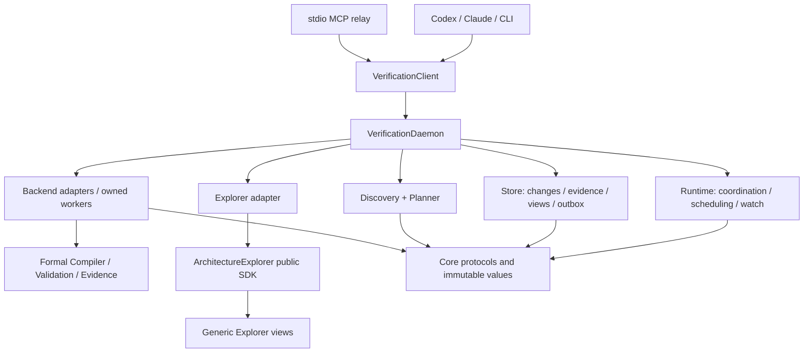

# Invar

## Purpose and Scope
System and SwiftPM package master. No parent. Design the daemon and SDK used by Agents and the user viewing ArchitectureExplorer. The target is a breaking development revision; implementation and behavioral acceptance are in progress. Current executable evidence and exact replacement gates are in [SDK transition](Documentation/SDK-TRANSITION.md). The implemented host remains Swift 6.4.1 / macOS 27 arm64; additional platforms are not claimed.

## Responsibilities and Boundaries
Invar generates a declarative C4 workspace from explicitly scoped implementation and configuration. Its verification subsystem owns observed changes, approved obligations, planning, bounded execution, immutable evidence, applicability and its common Agent/user view. Formal owns source profiles, model semantics, independent checking and structured formal evidence. ArchitectureExplorer owns the source index, extension authorization/publication and generic rendering. All development dependencies remain sibling paths in Invar's Package.swift.

## Related Designs
| Design | Relationship | Contract Used | Summary | Cautions |
|---|---|---|---|---|
| [Core](Sources/VerificationCore/DESIGN.md) | child | Domain, change and evidence ports | Shared meaning | Separate status axes |
| [Discovery](Sources/VerificationDiscovery/DESIGN.md) | child | Candidate and observed delta analysis | Exact changes and conservative impact | No independent source parser/index |
| [Planner](Sources/VerificationPlanner/DESIGN.md) | child | Immutable plan DAG | Capability matching | No implicit execution |
| [Runtime](Sources/VerificationRuntime/DESIGN.md) | child | Scheduling and monitoring | Workspace operations | Explicit resource ownership |
| [Backends](Sources/VerificationBackends/DESIGN.md) | child | Method-specific execution | Static, Formal, Native, Fuzz | Preserve semantic scope |
| [Store](Sources/VerificationStore/DESIGN.md) | child | Durable operations/evidence | Single daemon writer | Schema 2 replacement |
| [Explorer adapter](Sources/VerificationExplorer/DESIGN.md) | child | Authorized inputs and projections | Source and user view | Lower owner contract |
| [Client](Sources/VerificationClient/DESIGN.md) | child | Authenticated client SDK | CLI/MCP/programmatic clients | Private fixed-scope profiles and explicit session lifecycle |
| [Formal bridge](Sources/VerificationFormal/DESIGN.md) | child | Original Formal query/lease types | Authorized remote reading | No duplicated formal meaning |
| [Daemon](Sources/VerificationDaemon/DESIGN.md) | child | Workspace composition | Lifecycle and workers | Actual daemon/worker composition |
| [Map generator](Sources/InvarMap/DESIGN.md) | child | Offline Structurizr DSL generation | Scoped implementation and configuration | No verification claims or workspace execution |
| [Executable](Sources/invar/DESIGN.md) | child | Entry points and MCP relay | Same client-backed workflow | Old entry paths retire at cutover |
| [Owned Explorer fixture](Tests/Fixtures/ExplorerHost/DESIGN.md) | child test package | Actual separate host/client/Provider processes | Integration evidence | Unique temporary workspaces only |
| [SQLite adapter](Sources/CInvarSQLite/DESIGN.md) | child | Native SQLite boundary | Store dependency | Distinct from Explorer's CSQLite |
| [ArchitectureExplorer](https://github.com/1amageek/ArchitectureExplorer/blob/main/DESIGN.md) | depends on | Public Client/IR/Extensions | Source/renderer authority | Provider supplies scoped evidence only |
| [Formal](https://github.com/1amageek/swift-formal/blob/main/DESIGN.md) | depends on | Compiler, Validation, Evidence | Semantic authority | Source correspondence UNVALIDATED |
| [Swift MCP SDK](https://github.com/1amageek/swift-sdk/blob/main/README.md) | depends on | MCP Server/StdioTransport | Agent relay | No task-side dependency edits |

## Architecture

This is the target dependency/composition graph. Port implementations are injected by Daemon; Runtime never imports concrete Store/Backend. Client does not import Store, Runtime, FormalCompiler or FormalValidation. Its formal reader consumes the data-only VerificationFormal/ FormalEvidence SDK contracts. No reverse dependency from Formal or Explorer to Invar. FormalEvidence is an independently owned public SDK, not an Invar model parser.

## Contracts and Invariants
- One canonical workspace/OS user has one Invar execution authority and one Explorer source authority. Frontend lifetime does not own watches or verification.
- A change is an observation of exact before/after inputs plus an Agent claim. A claim is neither exclusive authorship, an oracle nor execution authority. [Changes](Sources/VerificationCore/Changes/DESIGN.md) owns the semantics.
- Original evidence is immutable. New inputs append applicability associations. [Evidence](Sources/VerificationCore/Evidence/DESIGN.md) owns the common committed ChangeVerificationView read by Agent and GUI.
- Execution, truth, domain, source correspondence, coverage, attribution, extraction and applicability remain independent. Source/model provenance never upgrades UNVALIDATED semantics; missing Actor semantics is explicitly unsupported.
- Planning, inspection and verification consume sealed inputs and declared budgets. No live-workspace fallback or hidden project scripts/downloads. Admission includes control, storage, recovery and cleanup costs.
- Authentication, approved properties and execution grants are separate. User-code Lean, Native and Fuzz require supported isolation and explicit authority; extension approval alone cannot grant them.
- No legacy schema/API compatibility is required. Replacement is coordinated with all callers and behavioral gates; deletion never silently discards old private data.

## Runtime Flows
```text
start -> recover durable authority -> connect authorized Explorer Provider
Agent begin -> capture fixed baseline -> open -> Agent edits -> seal after snapshot
 -> observed delta/impact -> immutable plan -> authorized demand -> admitted workers
 -> immutable evidence + applicability association -> committed common view
 -> MCP/SDK reads + outbox -> atomic Explorer projection
source changes -> uncertain applicability -> durable watch -> recapture/replan
```
Provider publication generation is reserved before the corresponding work and retained through delivery; result completion cannot acquire a newer generation. Store commit and external publication are separate failure domains. The [Publication](Sources/VerificationExplorer/Publication/DESIGN.md) outbox owns reconciliation. Full private generated-source preview requires additional owner-provided mediation; existing generic structural graph support is a separate capability.

## State, Ownership, and Lifecycle
| Owner | State / lifetime |
|---|---|
| Daemon Hosting | Principal/policy, IPC sessions and workspace composition; explicit start through stop |
| Runtime | Durable operations, watch interests, shared execution/resource reservations; survive frontend disconnect |
| Store | Writer lock, immutable blobs, baselines, evidence, associations, read pins and outbox; close last |
| Explorer adapter | Registration, heartbeat, input leases and publication session; daemon lifetime |
| Worker supervisor | Tool/process group and scratch; admission through durable result and complete reap |
| Client session | Connection, observation and subscriptions; close never stops shared work |

Child designs own actual state machines and failure contracts. No deinit performs synchronous waits or schedules unowned async cleanup.

## Failure, Concurrency, and Constraints
Independent ready jobs from different plans can overlap; shared keys deduplicate executions while run demands retain separate authorization/cancellation. No whole-plan tail serializes unrelated work. Timeout, resource limit, cancellation, interrupted and outcomeUnknown are distinct. Logical reservation accounting is not a hard OS physical quota; stronger unsupported enforcement is rejected explicitly.

Policy owners choose limits using user budgets, backend/receiver caps and measured supported profiles. Bounds and cleanup are correctness contracts. Native macOS is the implemented platform; this design adds no WASM/Embedded/GPU claim.

## Verification and Change Impact
[Transition](Documentation/SDK-TRANSITION.md) separates source facts, target changes, removal order and ID/IC/IE/IV/IS gates. [Verification plan](Documentation/VERIFICATION-PLAN.md) retains functional requirement ownership. Changes to child contracts recheck direct consumers, then this composition. No new SDK behavior follows from document checks or prior schema-1 tests.

- [VerificationFormal](Sources/VerificationFormal/DESIGN.md): typed Invar read leases/queries using original FormalEvidence models; no compiler/verifier ownership.

The default Agent/Explorer view is the acknowledged complete published head; [Evidence](Sources/VerificationCore/Evidence/DESIGN.md) owns selection semantics. Original per-operation references expose unpublished/failed/partial history. Publication generation, assessment sequence and source uncertainty remain distinct.

The [Explorer evidence delivery contract](Documentation/EXPLORER-EVIDENCE.md) identifies the producer-owned records and publication guarantees.

The [whole-project verification workflow](plugins/invar/skills/verify-project/SKILL.md) and [plugin acceptance contract](plugins/invar/SPEC.md) own complete acceptance inventories and the evidence requirements for Specification Verification, Implementation Model Verification and Source-to-Model Validation. The plugin report builder consumes receipts and grants no new execution authority.
