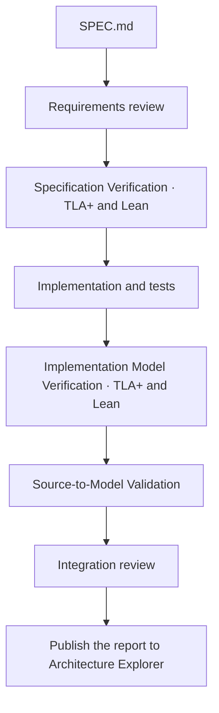
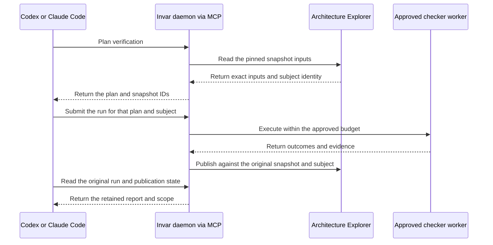
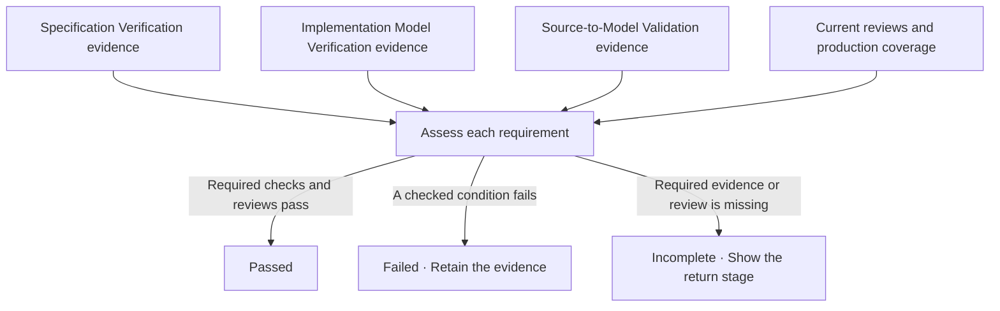

# Invar

Invar coordinates formal verification for a software workspace. Codex, Claude Code, and the CLI submit work to a shared local daemon. Invar captures exact inputs, runs approved checks, retains evidence, and publishes results to the matching Architecture Explorer snapshot. The package also provides a Swift client SDK.

## Verification workflow

The two TLA+ and Lean verification stages answer different questions. **Specification Verification** checks an independently authored model of the requirements before implementation. **Implementation Model Verification** checks models generated from supported production code against those requirements after implementation.



| Assessment | Input and result |
|---|---|
| **Specification Verification** | Derive obligations from `SPEC.md` independently of the implementation. TLA+ checks behavior such as state transitions and concurrent operations within stated bounds. Lean proves properties such as invariants and contracts under stated assumptions. |
| **Implementation Model Verification** | Use swift-formal to generate a model from supported production code and run the applicable TLA+ or Lean checks for the named conditions. The result establishes the checked property within the generated model's stated scope. |
| **Source-to-Model Validation** | Establish that the generated model preserves the relevant behavior of the exact source files. The current generated-model workflow reports this as `UNVALIDATED`. |

Review each stage before proceeding. If a review finds a problem, return to the stage that owns it and repeat the affected checks and reviews. For an existing-code audit, Invar can retain downstream diagnostics while an earlier stage is incomplete. Whole-project success requires evidence for every required assessment, coverage of the declared production inputs, and all five stage reviews. Missing evidence keeps the report incomplete and identifies the stage to return to. [Project verification contract](plugins/invar/references/project-verification.md)

## Run verification from an agent

The local Invar plugin bundles four skills and a stdio MCP server for Codex and Claude Code.

| Skill | Use it to |
|---|---|
| `$verify-project` | Review the complete requirements inventory, run the verification stages, and publish the whole-project report. [Verify Project](plugins/invar/skills/verify-project/SKILL.md) |
| `$verify-spec` | Run scoped **Specification Verification**. Keep authored TLA+ and Lean models under `Verification/Specifications/<subject>/`. [Specification Verification](plugins/invar/skills/verify-spec/SKILL.md) |
| `$formal-verification` | Run scoped **Implementation Model Verification**. Keep node-level preconditions and expected results in `Verification/<subject>/properties.json`. [Implementation Model Verification](plugins/invar/skills/formal-verification/SKILL.md) |
| `$generate-architecture` | Inspect requirements, implementation, and configuration to build or update `ARCHITECTURE.dsl` for Explorer's C1 and C2 Map. [Generate Architecture](plugins/invar/skills/generate-architecture/SKILL.md) |

Run the agent in the target workspace. For a snapshot-bound run, start with an indexed Explorer workspace, an authorized Invar connection, and the host-approved configuration for the target. For the Map's **Verify project** action, place `Verification/Project/invar.json` relative to the selected system or container's declaration directory. [Project action contract](plugins/invar/SPEC.md#project-verification-action)



The daemon keeps accepted runs and watches active when an agent disconnects. The default current view follows the acknowledged Explorer head. Per-operation history retains incomplete or failed runs and their original evidence. In the Map, open a report from the system or container's options. On a source node, use **Verify model** or open the result already attached to that node. [Daemon and SDK design](DESIGN.md) · [Evidence delivery](Documentation/EXPLORER-EVIDENCE.md)

## Read the result



An execution can finish and publish an incomplete report. Check the verdict separately from execution and publication. The report retains checked conditions, model bounds, unsupported production inputs, and review findings. Model generation and regression tests contribute evidence about their own scope. [Support and limits](Documentation/SUPPORT.md) · [Example of a reviewed project run](Verification/ProjectWorkflow-RESULT.md)

## Build and install locally

Use Swift 6.4.1, Python 3, and macOS 27 on Apple Silicon. Place the `ArchitectureExplorer`, `Formal`, and `swift-sdk` checkouts beside Invar. SwiftPM uses the sibling paths declared in `Package.swift`. From the parent directory, clone the four packages with these directory names.

```sh
git clone https://github.com/1amageek/Invar.git Invar
git clone https://github.com/1amageek/ArchitectureExplorer.git ArchitectureExplorer
git clone https://github.com/1amageek/swift-formal.git Formal
git clone https://github.com/1amageek/swift-sdk.git swift-sdk
```

From the Invar checkout, build the CLI and prepare a marketplace for your target. Choose a new output directory for the marketplace.

```sh
python3 ../Formal/Tools/run-with-timeout.py --seconds 180 -- \
  swift build --build-system native -Xswiftc -target -Xswiftc arm64-apple-macosx27.0
python3 Tools/prepare-plugin.py --workspace /path/to/target --output /path/to/local-marketplace
```

The generated MCP configuration uses the absolute path to the executable and workspace. For Codex, run these commands in a terminal.

```sh
codex plugin marketplace add /path/to/local-marketplace
codex plugin add invar@invar-local
```

For Claude Code, use its plugin commands.

```text
/plugin marketplace add /path/to/local-marketplace
/plugin install invar@invar-local
```

For snapshot-bound verification, start the daemon with the policy reviewed for that workspace. The policy authorizes the exact configuration, executables, and capabilities. Start Explorer for the same workspace and authorize the Invar Provider there. [Trust and execution boundaries](Documentation/TRUST.md) · [CLI reference](Sources/invar/Commands/DESIGN.md)

```sh
.build/debug/invar daemon start --workspace /path/to/target --policy /path/to/policy.json
.build/debug/invar daemon status --workspace /path/to/target
```

## Generate a Map from the CLI

The offline `invar map` command reads selected Swift packages and writes a generator-owned `ARCHITECTURE.dsl`, with package-owned fragments where needed. Its supported inputs include conventional SwiftPM executable targets with an `@main` entry and supported SwiftWeb configurations. Run it from the target workspace with `invar` on your PATH.

```sh
invar map --workspace . --system "Demo" --package . --out ARCHITECTURE.dsl
```

Repeat `--package` with workspace-relative paths to include multiple packages. The generator records references to the input files and protects existing authored DSL. [Map generator design](Sources/InvarMap/DESIGN.md)

[System design](DESIGN.md) · [CLI and MCP integration](Sources/invar/DESIGN.md) · [Evidence schemas](Schemas/README.md) · [Development progress](PROGRESS.md)
