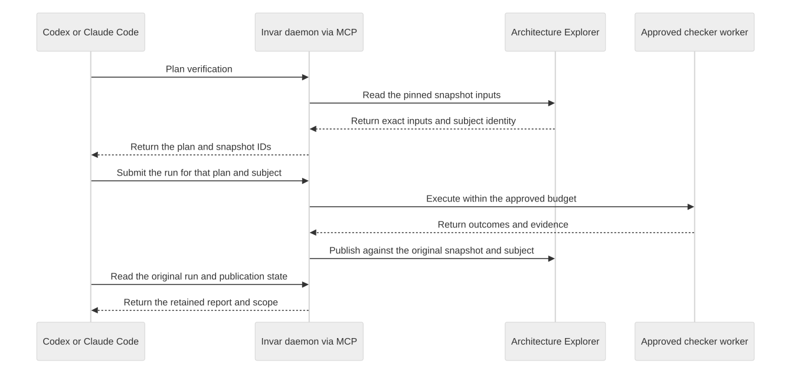

# Invar

Invar coordinates formal verification for a software workspace. Codex, Claude Code, and the CLI submit work to a shared local daemon. Invar captures exact inputs, runs requested checks, retains evidence, and publishes results to the matching Architecture Explorer snapshot. The package also provides a Swift client SDK.

## Verification workflow

The two TLA+ and Lean verification stages answer different questions. **Specification Verification** checks an independently authored model of the requirements before implementation. **Implementation Model Verification** checks models generated from supported production code against those requirements after implementation.


[Mermaid source](Documentation/Diagrams/verification-workflow.mmd)

| Assessment | Input and result |
|---|---|
| **Specification Verification** | Derive obligations from `SPEC.md` independently of the implementation. TLA+ checks behavior such as state transitions and concurrent operations within stated bounds. Lean proves properties such as invariants and contracts under stated assumptions. |
| **Implementation Model Verification** | Use swift-formal to generate a model from supported production code and run the applicable TLA+ or Lean checks for the named conditions. The result establishes the checked property within the generated model's stated scope. |
| **Source-to-Model Validation** | Establish that the generated model preserves the relevant behavior of the exact source files. The current generated-model workflow reports this as `UNVALIDATED`. |

Review each stage before proceeding. If a review finds a problem, return to the stage that owns it and repeat the affected checks and reviews. For an existing-code audit, Invar can retain downstream diagnostics while an earlier stage is incomplete. Whole-project success requires evidence for every required assessment, coverage of the declared production inputs, and all five stage reviews. Missing evidence keeps the report incomplete and identifies the stage to return to. [Project verification contract](Sources/InvarSkills/skills/verify-project/references/project-verification.md)

For Swift projects, the agent runs deslop for structural checks. The current workflow uses code-review to check affected behavior after structural checks and tests, before Implementation Model Verification. [Implementation review](Sources/InvarSkills/skills/verify-project/SKILL.md#review-the-implementation-behavior)

## Run verification from an agent

Invar serves bundled skills from its stdio MCP server using the [MCP Skills extension](https://modelcontextprotocol.io/extensions/skills/overview). Connect to `invar mcp` from a project directory. An extension-aware client discovers skills with `skills/list`, looks up entries with `skills/get`, and reads their files using `resources/read`. Each manifest includes the byte sizes and SHA-256 digests of the skill and its supporting files. Clients with standard MCP Resources can also discover the entrypoints through `resources/list`.

| Skill | Use it to |
|---|---|
| `use-invar` | Inspect workspace readiness, repair execution configuration and check that project inputs link in Explorer. [Use Invar](Sources/InvarSkills/skills/use-invar/SKILL.md) |
| `verify-project` | Review the complete requirements inventory, run the verification stages, and publish the whole-project report. [Verify Project](Sources/InvarSkills/skills/verify-project/SKILL.md) |
| `requirements-engineering` | Establish verifiable requirements and acceptance criteria. [Requirements Engineering](Sources/InvarSkills/skills/requirements-engineering/SKILL.md) |
| `scope-analysis` | Analyze change boundaries and impact, then review the final diff against the requirements. [Scope Analysis](Sources/InvarSkills/skills/scope-analysis/SKILL.md) |
| `scope-management` | Maintain the authorized scope and judge completion from current evidence. [Scope Management](Sources/InvarSkills/skills/scope-management/SKILL.md) |
| `code-review` | Review affected behavior, downstream consumers and verification gaps. Available in the current checkout. [Code Review](Sources/InvarSkills/skills/code-review/SKILL.md) |
| `verify-spec` | Run scoped **Specification Verification**. Keep authored TLA+ and Lean models under `Verification/Specifications/<subject>/`. [Specification Verification](Sources/InvarSkills/skills/verify-spec/SKILL.md) |
| `formal-verification` | Run scoped **Implementation Model Verification**. Keep node-level preconditions and expected results in `Verification/<subject>/properties.json`. [Implementation Model Verification](Sources/InvarSkills/skills/formal-verification/SKILL.md) |
| `generate-architecture` | Inspect requirements, implementation, and configuration to build or update `ARCHITECTURE.dsl` for Explorer's C1 and C2 Map. [Generate Architecture](Sources/InvarSkills/skills/generate-architecture/SKILL.md) |
| `generate-sequences` | Write or review `SEQUENCES.dsl` for the ordered interactions of a use case in Explorer. [Generate Sequences](Sources/InvarSkills/skills/generate-sequences/SKILL.md) |

Run the agent in the target workspace. For a snapshot-bound run, start with an indexed Explorer workspace and the verification configuration for the target. For the Map's **Verify project** action, place `Verification/Project/invar.json` relative to the selected system or container's declaration directory. [Project action contract](Sources/InvarSkills/SPEC.md#project-verification-action)



[Mermaid source](Documentation/Diagrams/agent-verification.mmd)

The daemon keeps accepted runs and watches active when an agent disconnects. The default current view follows the acknowledged Explorer head. Per-operation history retains incomplete or failed runs and their original evidence. In the Map, open a report from the system or container's options. On a source node, use **Verify model** or open the result already attached to that node. [Daemon and SDK design](DESIGN.md) · [Evidence delivery](Documentation/EXPLORER-EVIDENCE.md)

## Read the result


[Mermaid source](Documentation/Diagrams/verification-verdict.mmd)

An execution can finish and publish an incomplete report. Check the verdict separately from execution and publication. The report retains checked conditions, model bounds, unsupported production inputs, and review findings. Model generation and regression tests contribute evidence about their own scope. [Support and limits](Documentation/SUPPORT.md) · [Example of a reviewed project run](Verification/ProjectWorkflow-RESULT.md)

## Install with Mint

Use macOS 27 or later on Apple Silicon, Swift 6.4.1, and [Mint](https://github.com/yonaskolb/Mint). Add Mint's bin directory (default: `~/.mint/bin`) to your `PATH`.

```sh
mint install 1amageek/Invar@0.1.6 invar
invar
```

The Invar installation includes the Architecture Explorer host and browser assets. A single `invar` command starts both workspace services and opens Explorer.

From a Git checkout or worktree, including a nested source directory:

```sh
invar
invar status
invar stop
```

`invar` prints the resolved absolute path, starts or reuses the workspace services, and opens Explorer. Use `--workspace PATH` to select a different directory, or `--no-open` to get the one-time browser URL. Closing the browser frontend leaves the verification daemon available. Run `invar mcp` in the agent's project directory. MCP shares the workspace daemon or starts it on first use. Explicit stop holds until the next explicit start.

Invar registers automatically with its bundled Explorer for snapshot access and result publication. To upgrade a workspace with running services, close Explorer and run the following from the project root before installing the new version.

```sh
old_invar=$(realpath "$(command -v invar)")
"$old_invar" stop
old_host="$(dirname "$old_invar")/Invar_invar.bundle/Contents/Resources/architecture-host"
"$old_host" stop --workspace "$PWD"
```

Run the new `invar` in that workspace after installation. The new pair registers again and keeps previously published results. Repeat for each workspace with running services. If your verification configuration still contains legacy `approved` fields, remove them and prepare a fresh plan from the current snapshot.

## Connect an agent to Invar MCP

Invar 0.1.6 serves its bundled skills through MCP. Run `command -v invar` to get the installed executable path for the commands below. For a source checkout, run `swift build --product invar` and use the absolute path to `.build/debug/invar`. The executable and its adjacent SwiftPM bundles supply Explorer and the skills.

Register the executable once in your agent.

```sh
codex mcp add invar -- /absolute/path/to/invar mcp
claude mcp add --scope user --transport stdio invar -- /absolute/path/to/invar mcp
```

Open the target repository as the agent's working directory and ask it to use Invar. The MCP server directs it to `use-invar` for setup and `verify-project` for project-wide preparation and verification. Projects may also add the following verification reminder to `AGENTS.md`.

```markdown
## Project verification

When asked to verify this project, read `skill://invar/verify-project/SKILL.md` through Invar MCP. Resolve the target project and first open Architecture Explorer in the current Codex chat’s in-app browser using the Invar MCP server’s executable with `--workspace <workspace-root> --codex-browser`. Open the local URL printed by the command with the in-app browser control, or reuse a working Explorer tab already open for that workspace. Confirm the workspace path and that its architecture diagram is visible before planning or running verification. Follow the skill’s linked guidance through MCP, including its startup procedure for source-free workspaces. Run the requested checks and read their retained results through Invar MCP. Report any stage or check without evidence as incomplete.
```

In Codex, ask for verification in plain language. For Claude Code, make the same project instructions available in `CLAUDE.md`. Invar upgrades carry the current skill catalog and tool implementation together. Keep the registered executable path stable across upgrades. After confirming the direct connection, disable any previously installed Invar agent plugin to avoid duplicate entries.

CLI and MCP share the workspace daemon. Start Invar in the workspace to capture inputs and publish results against an Explorer snapshot. [Trust and execution boundaries](Documentation/TRUST.md) · [CLI reference](Sources/invar/Commands/DESIGN.md)

## Generate a Map from the CLI

The offline `invar map` command reads selected Swift packages and writes a generator-owned `ARCHITECTURE.dsl`, with package-owned fragments where needed. Its supported inputs include conventional SwiftPM executable targets with an `@main` entry and supported SwiftWeb configurations. Run it from the target workspace with `invar` on your PATH.

```sh
invar map --workspace . --system "Demo" --package . --out ARCHITECTURE.dsl
```

Repeat `--package` with workspace-relative paths to include multiple packages. The generator records references to the input files and protects existing authored DSL. [Map generator design](Sources/InvarMap/DESIGN.md)

[System design](DESIGN.md) · [CLI and MCP integration](Sources/invar/DESIGN.md) · [Evidence schemas](Schemas/README.md) · [Development progress](PROGRESS.md)
