# Invar

Invar coordinates formal verification for a software workspace. Codex, Claude Code, and the CLI submit work to a shared local daemon. Invar captures exact inputs, runs requested checks, retains evidence, and publishes results to the matching Architecture Explorer snapshot. The package also provides a Swift client SDK.

## Verification workflow

The two TLA+ and Lean verification stages answer different questions. **Specification Verification** checks an independently authored model of the requirements before implementation. **Implementation Model Verification** checks models generated from supported production code against those requirements after implementation.



[Mermaid source](Documentation/Diagrams/verification-workflow.mmd)

| Assessment | Input and result |
|---|---|
| **Specification Verification** | Derive obligations from `SPEC.md` independently of the implementation. TLA+ checks behavior such as state transitions and concurrent operations within stated bounds. Lean proves properties such as invariants and contracts under stated assumptions. |
| **Implementation Model Verification** | Use swift-formal to generate a model from supported production code and run the applicable TLA+ or Lean checks for the named conditions. The result establishes the checked property within the generated model's stated scope. |
| **Source-to-Model Validation** | Establish that the generated model preserves the relevant behavior of the exact source files. The current generated-model workflow reports this as `UNVALIDATED`. |

Review each stage before proceeding. If a review finds a problem, return to the stage that owns it and repeat the affected checks and reviews. For an existing-code audit, Invar can retain downstream diagnostics while an earlier stage is incomplete. Whole-project success requires evidence for every required assessment, coverage of the declared production inputs, and all five stage reviews. Missing evidence keeps the report incomplete and identifies the stage to return to. [Project verification contract](plugins/invar/references/project-verification.md)

For Swift projects, the agent runs deslop as part of implementation review before Implementation Model Verification. [Structural review](plugins/invar/skills/verify-project/SKILL.md#check-implementation-structure)

## Run verification from an agent

The Invar plugin bundles eight skills and a stdio MCP server for Codex and Claude Code.

| Skill | Use it to |
|---|---|
| `$verify-project` | Review the complete requirements inventory, run the verification stages, and publish the whole-project report. [Verify Project](plugins/invar/skills/verify-project/SKILL.md) |
| `$requirements-engineering` | Establish verifiable requirements and acceptance criteria. [Requirements Engineering](plugins/invar/skills/requirements-engineering/SKILL.md) |
| `$scope-analysis` | Analyze change boundaries and impact, then review the final diff against the requirements. [Scope Analysis](plugins/invar/skills/scope-analysis/SKILL.md) |
| `$scope-management` | Maintain the authorized scope and judge completion from current evidence. [Scope Management](plugins/invar/skills/scope-management/SKILL.md) |
| `$verify-spec` | Run scoped **Specification Verification**. Keep authored TLA+ and Lean models under `Verification/Specifications/<subject>/`. [Specification Verification](plugins/invar/skills/verify-spec/SKILL.md) |
| `$formal-verification` | Run scoped **Implementation Model Verification**. Keep node-level preconditions and expected results in `Verification/<subject>/properties.json`. [Implementation Model Verification](plugins/invar/skills/formal-verification/SKILL.md) |
| `$generate-architecture` | Inspect requirements, implementation, and configuration to build or update `ARCHITECTURE.dsl` for Explorer's C1 and C2 Map. [Generate Architecture](plugins/invar/skills/generate-architecture/SKILL.md) |
| `$generate-sequences` | Write or review `SEQUENCES.dsl` for the ordered interactions of a use case in Explorer. [Generate Sequences](plugins/invar/skills/generate-sequences/SKILL.md) |

Run the agent in the target workspace. For a snapshot-bound run, start with an indexed Explorer workspace and the verification configuration for the target. For the Map's **Verify project** action, place `Verification/Project/invar.json` relative to the selected system or container's declaration directory. [Project action contract](plugins/invar/SPEC.md#project-verification-action)


[Mermaid source](Documentation/Diagrams/agent-verification.mmd)

The daemon keeps accepted runs and watches active when an agent disconnects. The default current view follows the acknowledged Explorer head. Per-operation history retains incomplete or failed runs and their original evidence. In the Map, open a report from the system or container's options. On a source node, use **Verify model** or open the result already attached to that node. [Daemon and SDK design](DESIGN.md) · [Evidence delivery](Documentation/EXPLORER-EVIDENCE.md)

## Read the result



[Mermaid source](Documentation/Diagrams/verification-verdict.mmd)

An execution can finish and publish an incomplete report. Check the verdict separately from execution and publication. The report retains checked conditions, model bounds, unsupported production inputs, and review findings. Model generation and regression tests contribute evidence about their own scope. [Support and limits](Documentation/SUPPORT.md) · [Example of a reviewed project run](Verification/ProjectWorkflow-RESULT.md)

## Install with Mint

Use macOS 27 or later on Apple Silicon, Swift 6.4.1, and [Mint](https://github.com/yonaskolb/Mint). Add Mint's bin directory (default: `~/.mint/bin`) to your `PATH`.

```sh
mint install 1amageek/Invar@0.1.5 invar
invar
```

The Invar installation includes the Architecture Explorer host and browser assets. A single `invar` command starts both workspace services and opens Explorer.

From a Git checkout or worktree, including a nested source directory:

```sh
invar
invar status
invar stop
```

`invar` prints the resolved absolute path, starts or reuses the workspace services, and opens Explorer. Use `--workspace PATH` to select a different directory, or `--no-open` to get the one-time browser URL. Closing the browser frontend leaves the verification daemon available. The plugin runs `invar mcp` in the agent's project directory. MCP shares the workspace daemon or starts it on first use. Explicit stop holds until the next explicit start.

Invar registers automatically with its bundled Explorer for snapshot access and result publication. To upgrade a workspace with running services, close Explorer and run the following from the project root before installing the new version.

```sh
old_invar=$(realpath "$(command -v invar)")
"$old_invar" stop
old_host="$(dirname "$old_invar")/Invar_invar.bundle/Contents/Resources/architecture-host"
"$old_host" stop --workspace "$PWD"
```

Run the new `invar` in that workspace after installation. The new pair registers again and keeps previously published results. Repeat for each workspace with running services.

## Install the agent plugin

The Invar marketplace ships the skills and starts its MCP server with `invar mcp`. Make `invar` available on the agent's `PATH` and open the target project as the agent's working directory.

For Codex, run these commands in a terminal.

```sh
codex plugin marketplace add 1amageek/Invar --ref 0.1.5
codex plugin add invar@invar-local
```

For Claude Code, use its plugin commands.

```text
/plugin marketplace add 1amageek/Invar#0.1.5
/plugin install invar@invar-local
```

CLI and MCP connect to the workspace daemon through the current macOS user’s private socket. Start Invar in the workspace to capture inputs and publish results against an Explorer snapshot. [Trust and execution boundaries](Documentation/TRUST.md) · [CLI reference](Sources/invar/Commands/DESIGN.md)

```sh
invar --workspace /path/to/target
invar status --workspace /path/to/target
```

When updating an existing workspace, remove the old `approved` fields from its verification configuration. Stop the running daemon with its current binary before upgrading. After upgrading, start Invar and prepare a fresh plan from the current snapshot. Existing evidence stays in the local store.

For development, run `swift build --product invar` from the Invar checkout. To prepare a workspace-specific plugin with an absolute path to a custom or Mint-installed binary, run `python3 Tools/prepare-plugin.py --workspace /path/to/target --binary "$(command -v invar)" --output /path/to/local-marketplace`. Omit `--binary` to use `.build/debug/invar`.

## Generate a Map from the CLI

The offline `invar map` command reads selected Swift packages and writes a generator-owned `ARCHITECTURE.dsl`, with package-owned fragments where needed. Its supported inputs include conventional SwiftPM executable targets with an `@main` entry and supported SwiftWeb configurations. Run it from the target workspace with `invar` on your PATH.

```sh
invar map --workspace . --system "Demo" --package . --out ARCHITECTURE.dsl
```

Repeat `--package` with workspace-relative paths to include multiple packages. The generator records references to the input files and protects existing authored DSL. [Map generator design](Sources/InvarMap/DESIGN.md)

[System design](DESIGN.md) · [CLI and MCP integration](Sources/invar/DESIGN.md) · [Evidence schemas](Schemas/README.md) · [Development progress](PROGRESS.md)
